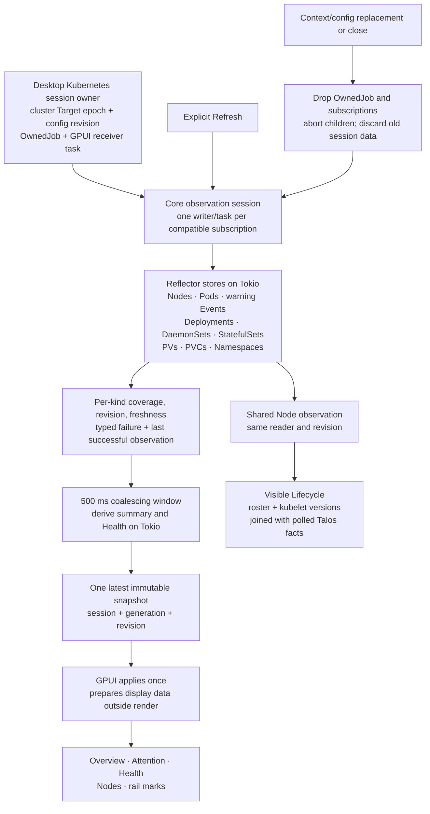

# Roadmap

What has landed, what comes next and in what order. Update this file in the same commit as the work it describes: move a step to Done with its commit, and keep open checks honest.

## Ground rules

These hold for every step until a later one deliberately changes them.

- **Writes follow the write model.** A change to a Kubernetes object goes through core's write framework ([WRITE_MODEL.md](WRITE_MODEL.md)): tiered by risk, limited by the cluster entry's protection level, and audited. Until an action lands, the app lists, watches, gets and streams logs, and the existing exceptions stand, each starting only from an explicit action: pod exec creates a `pods/exec` ([POD_EXEC.md](POD_EXEC.md#decisions)), port forwarding creates a `pods/portforward` that changes no objects but reaches whatever the port serves, admin endpoints included ([PORT_FORWARD.md](PORT_FORWARD.md#decisions)), and Talos node operations stay on the Operations page behind their own preflight and confirmation. An agent's checks stay read-only ([AGENTS.md](../AGENTS.md#cluster-safety)).
- **The chosen context only.** Connect to the context the user named, or the one the kubeconfig marks as current. When a named context is missing, report it; never swap in another.
- **Identity, not position.** Rows and documents are identified by connection, resource, namespace, name and UID. A response for another selection or object incarnation is dropped.
- **Honest states.** Loading, loaded, refused, failed and stale are distinct. An unreadable collection is never shown as empty, and failed refreshes keep the previous data marked stale.
- **Source reuse.** Code taken from Kubeli (MIT) keeps its notice and is recorded in a NOTICE file. Rubick is studied for behavior, not copied. See [the reuse policy](REFERENCES.md#reuse-policy).

## Done

One row per step: its commit, its pull requests, and where to read what it did, a feature doc or the release in [CHANGELOG.md](../CHANGELOG.md). The rows' longer accounts are in this file's history before #587.

| Step | Commit | Pull requests | Read more |
|------|--------|---------------|-----------|
| Agent in the dock D1c. The Agent dock tab: setup, per-cluster access, the model picker, the transcript, steps and Stop ([#874](https://github.com/skel84/freshkube/issues/874), [#908](https://github.com/skel84/freshkube/issues/908)) | — | [#963](https://github.com/skel84/freshkube/pull/963) | [agent.md](features/agent.md#the-dock-tab-slice-d1c); the page following the agent's reads is D1d, and Settings' per-entry switch and audit Source remain |
| Agent in the dock D1b. The ACP client, the opencode profile, lock-down and version check ([#874](https://github.com/skel84/freshkube/issues/874), [#907](https://github.com/skel84/freshkube/issues/907)) | — | [#912](https://github.com/skel84/freshkube/pull/912) | [agent.md](features/agent.md); the endpoint, the dock tab and following remain D1a, D1c and D1d, and the live check on a real opencode is the lead's |
| Results forward 2. Explicit Applications actions and app-owned routes ([#268](https://github.com/skel84/freshkube/issues/268)) | — | [#841](https://github.com/skel84/freshkube/pull/841) | [PORT_FORWARD.md](PORT_FORWARD.md#tekton-results), [applications.md](features/applications.md) |
| Agent D1a. `agent_reads` in core, the per-cluster access gate and the loopback read endpoint ([#906](https://github.com/skel84/freshkube/issues/906), part of [#874](https://github.com/skel84/freshkube/issues/874)) | — | — | [agent.md](features/agent.md) |
| Database operators 2. Grouped table, verdict Inspector, Coroot evidence and the MariaDB reader ([#827](https://github.com/skel84/freshkube/issues/827)) | — | [#886](https://github.com/skel84/freshkube/pull/886) | [databases.md](features/databases.md); poolers' list, Prometheus lag, logs, observed history and success rate remain later slices |
| Database operators 1. Shared model and read-only CloudNativePG inventory ([#827](https://github.com/skel84/freshkube/issues/827)) | — | [#851](https://github.com/skel84/freshkube/pull/851) | [databases.md](features/databases.md); MariaDB, logs, observed history and success rate remain later slices |
| Results forward 1. Delivery transport and setup ([#268](https://github.com/skel84/freshkube/issues/268)) | — | [#824](https://github.com/skel84/freshkube/pull/824) | [SETUP_FILE.md](SETUP_FILE.md#the-file), [SUPPLY_CHAIN.md](SUPPLY_CHAIN.md#what-it-is-and-how-it-is-reached); app wiring is slice 2 above |
| Settings 4. Clusters and its Inspector ([#697](https://github.com/skel84/freshkube/issues/697)) | `2af002d` | [#756](https://github.com/skel84/freshkube/pull/756) | [settings.md](features/settings.md) |
| Settings 9. The Monitoring section ([#697](https://github.com/skel84/freshkube/issues/697)) | `2404fac` | [#753](https://github.com/skel84/freshkube/pull/753) | [settings.md](features/settings.md), [monitoring.md](features/monitoring.md) |
| Settings 6. Delivery sources and their pins ([#697](https://github.com/skel84/freshkube/issues/697)) | `d2f62e4` | [#752](https://github.com/skel84/freshkube/pull/752) | [settings.md](features/settings.md) |
| Settings 10. The Coroot section ([#697](https://github.com/skel84/freshkube/issues/697)) | `fc73384` | [#750](https://github.com/skel84/freshkube/pull/750) | [settings.md](features/settings.md) |
| Settings 5. Argo CD destinations ([#697](https://github.com/skel84/freshkube/issues/697)) | `567fa0d` | [#751](https://github.com/skel84/freshkube/pull/751) | [settings.md](features/settings.md) |
| Setup file 6. The README's annotated example ([#706](https://github.com/skel84/freshkube/issues/706)) | `928496f` | [#740](https://github.com/skel84/freshkube/pull/740) | [README.md](../README.md), [SETUP_FILE.md](SETUP_FILE.md) |
| Setup file 4. Settings saves to freshkube.yaml ([#706](https://github.com/skel84/freshkube/issues/706)) | `671a0bf` | [#747](https://github.com/skel84/freshkube/pull/747) | [settings.md](features/settings.md), [SETUP_FILE.md](SETUP_FILE.md#reload-on-change) |
| Setup file 5. Metrics from the setup file ([#706](https://github.com/skel84/freshkube/issues/706)) | `d03ee83` | [#744](https://github.com/skel84/freshkube/pull/744) | [monitoring.md](features/monitoring.md), [SETUP_FILE.md](SETUP_FILE.md#metrics) |
| Settings 8. The Connection section ([#697](https://github.com/skel84/freshkube/issues/697)) | `664f4a1` | [#724](https://github.com/skel84/freshkube/pull/724) | [settings.md](features/settings.md) |
| Settings 7. The General section ([#697](https://github.com/skel84/freshkube/issues/697)) | `c713a48` | [#719](https://github.com/skel84/freshkube/pull/719) | [settings.md](features/settings.md) |
| Settings 3. The area, its column and a page per section ([#697](https://github.com/skel84/freshkube/issues/697)) | `b91e521` | [#710](https://github.com/skel84/freshkube/pull/710) | [settings.md](features/settings.md) |
| Settings 2. Shared forms (`freshkube_ui::form`) ([#697](https://github.com/skel84/freshkube/issues/697)) | `63e8a95` | [#705](https://github.com/skel84/freshkube/pull/705) | [settings.md](features/settings.md), [DESIGN.md](DESIGN.md#the-settings-page) |
| Settings 1. The design and its style rules ([#697](https://github.com/skel84/freshkube/issues/697)) | `30372b9` | [#702](https://github.com/skel84/freshkube/pull/702) | [DESIGN.md](DESIGN.md#the-settings-page) |
| Applications crate ([#583](https://github.com/skel84/freshkube/issues/583), step 4) | `79c8fce` | [#723](https://github.com/skel84/freshkube/pull/723) | [applications.md](features/applications.md), [ARCHITECTURE.md](ARCHITECTURE.md#crates-and-their-direction) |
| Resources crate ([#583](https://github.com/skel84/freshkube/issues/583), step 3) | `648afcd` | [#717](https://github.com/skel84/freshkube/pull/717) | [resources.md](features/resources.md), [ARCHITECTURE.md](ARCHITECTURE.md#crates-and-their-direction) |
| The delivery chain 5.6. The chain across the workspace ([#564](https://github.com/skel84/freshkube/issues/564)) | #565 2a561c6, #566 b025b99, #569 76baaac, #567 89a98d6, #570 6e5a6bf, #571 afebc23, #574 2cccdb7, #575 90ab1f9 | [#565](https://github.com/skel84/freshkube/pull/565), [#566](https://github.com/skel84/freshkube/pull/566), [#569](https://github.com/skel84/freshkube/pull/569), [#567](https://github.com/skel84/freshkube/pull/567), [#570](https://github.com/skel84/freshkube/pull/570), [#571](https://github.com/skel84/freshkube/pull/571), [#574](https://github.com/skel84/freshkube/pull/574), [#575](https://github.com/skel84/freshkube/pull/575) | [applications.md](features/applications.md), [0.14.0](../CHANGELOG.md#0140-2026-10-11) |
| The delivery chain 5.6. The Changes list ([#564](https://github.com/skel84/freshkube/issues/564)) | `b54763d` | [#566](https://github.com/skel84/freshkube/pull/566) | [applications.md](features/applications.md), [0.14.0](../CHANGELOG.md#0140-2026-10-11) |
| Several clusters 4. Argo CD destinations ([#44](https://github.com/skel84/freshkube/issues/44)) | `05ffd94`, `08b4b88`, `6fcbc56` | [#558](https://github.com/skel84/freshkube/pull/558), [#560](https://github.com/skel84/freshkube/pull/560), [#561](https://github.com/skel84/freshkube/pull/561) | [applications.md](features/applications.md), [0.13.0](../CHANGELOG.md#0130-2026-10-09) |
| Applications 6. Open a part on another cluster ([#521](https://github.com/skel84/freshkube/issues/521)) | `69065a2` | [#553](https://github.com/skel84/freshkube/pull/553) | [applications.md](features/applications.md), [0.12.0](../CHANGELOG.md#0120-2026-10-09) |
| Applications 5. The column ([#521](https://github.com/skel84/freshkube/issues/521)) | `c798a96` | [#550](https://github.com/skel84/freshkube/pull/550) | [applications.md](features/applications.md), [0.12.0](../CHANGELOG.md#0120-2026-10-09) |
| Applications 4. Stacked Inspector floor ([#521](https://github.com/skel84/freshkube/issues/521)) | `8b92a37` | [#548](https://github.com/skel84/freshkube/pull/548) | [applications.md](features/applications.md), [0.12.0](../CHANGELOG.md#0120-2026-10-09) |
| All containers in one pod log ([#482](https://github.com/skel84/freshkube/issues/482), step 7) | `a8b35c3` ([PR #486](https://github.com/skel84/freshkube/pull/486)) | [#486](https://github.com/skel84/freshkube/pull/486) | [resources.md](features/resources.md), [0.10.0](../CHANGELOG.md#0100-2026-10-08) |
| The delivery chain, step 1: ownership and evidence ([#387](https://github.com/skel84/freshkube/issues/387), [#446](https://github.com/skel84/freshkube/pull/446), [#469](https://github.com/skel84/freshkube/pull/469)) | `7426386` | [#492](https://github.com/skel84/freshkube/pull/492) | [applications.md](features/applications.md), [0.10.0](../CHANGELOG.md#0100-2026-10-08) |
| Observability crate ([#53](https://github.com/skel84/freshkube/issues/53), B4) | `f7d0626` | [#480](https://github.com/skel84/freshkube/pull/480) | [0.10.0](../CHANGELOG.md#0100-2026-10-08) |
| Monitoring crate ([#53](https://github.com/skel84/freshkube/issues/53), B3) | `6d61796` | [#457](https://github.com/skel84/freshkube/pull/457) | [monitoring.md](features/monitoring.md), [0.9.0](../CHANGELOG.md#090-2026-10-08) |
| Small test and package cleanup | `2d3fb21` | [#436](https://github.com/skel84/freshkube/pull/436) | [0.9.0](../CHANGELOG.md#090-2026-10-08) |
| Security's table and Inspector ([#420](https://github.com/skel84/freshkube/issues/420), [#399](https://github.com/skel84/freshkube/issues/399)) | `5878aa7` | [#428](https://github.com/skel84/freshkube/pull/428) | [0.9.0](../CHANGELOG.md#090-2026-10-08) |
| Loading motion outside the shell ([#385](https://github.com/skel84/freshkube/issues/385), from #254) | `9cdd49b` | [#397](https://github.com/skel84/freshkube/pull/397) | [PERFORMANCE.md](PERFORMANCE.md#loading-rows-move-without-redrawing-the-shell-385), [0.9.0](../CHANGELOG.md#090-2026-10-08) |
| System services actions ([#46](https://github.com/skel84/freshkube/issues/46), step 6.11) | `60f15a2` | [#389](https://github.com/skel84/freshkube/pull/389) | [0.8.0](../CHANGELOG.md#080-2026-10-07) |
| Actions on the selection ([#46](https://github.com/skel84/freshkube/issues/46), step 6.10) | `3162db5` | [#367](https://github.com/skel84/freshkube/pull/367) | [0.8.0](../CHANGELOG.md#080-2026-10-07) |
| Cluster source seam ([#53](https://github.com/skel84/freshkube/issues/53), [#356](https://github.com/skel84/freshkube/issues/356)) | `680da9f` | [#369](https://github.com/skel84/freshkube/pull/369) | [0.8.0](../CHANGELOG.md#080-2026-10-07) |
| Coroot severity colours ([#226](https://github.com/skel84/freshkube/issues/226), item 2) | `76f4241` | [#344](https://github.com/skel84/freshkube/pull/344) | [0.8.0](../CHANGELOG.md#080-2026-10-07) |
| Pods row Logs ([#291](https://github.com/skel84/freshkube/issues/291), part 3 of 3) | `64f5e4b` | [#337](https://github.com/skel84/freshkube/pull/337) | [resources.md](features/resources.md), [0.8.0](../CHANGELOG.md#080-2026-10-07) |
| Pods Containers ([#291](https://github.com/skel84/freshkube/issues/291), part 2 of 3) | `81a293f` | [#329](https://github.com/skel84/freshkube/pull/329) | [resources.md](features/resources.md), [0.8.0](../CHANGELOG.md#080-2026-10-07) |
| Pods Restarts and order ([#291](https://github.com/skel84/freshkube/issues/291), part 1 of 3; [#321](https://github.com/skel84/freshkube/issues/321)) | `1d4812f` | [#325](https://github.com/skel84/freshkube/pull/325) | [resources.md](features/resources.md), [0.8.0](../CHANGELOG.md#080-2026-10-07) |
| Log Download ([#301](https://github.com/skel84/freshkube/issues/301), part 2 of 2) | `4438f65` | [#317](https://github.com/skel84/freshkube/pull/317) | [resources.md](features/resources.md), [0.8.0](../CHANGELOG.md#080-2026-10-07) |
| Workload Pod select and Timestamps ([#301](https://github.com/skel84/freshkube/issues/301), part 1 of 2) | `de020ab` | [#310](https://github.com/skel84/freshkube/pull/310) | [resources.md](features/resources.md), [0.8.0](../CHANGELOG.md#080-2026-10-07) |
| Details \| YAML ([#290](https://github.com/skel84/freshkube/issues/290), part 2) | `a94c464` | [#322](https://github.com/skel84/freshkube/pull/322) | [resources.md](features/resources.md), [0.8.0](../CHANGELOG.md#080-2026-10-07) |
| Details drawer ([#290](https://github.com/skel84/freshkube/issues/290), part 1) | `d84eb17` | [#315](https://github.com/skel84/freshkube/pull/315) | [resources.md](features/resources.md), [0.8.0](../CHANGELOG.md#080-2026-10-07) |
| Log dock ([#284](https://github.com/skel84/freshkube/issues/284), part 1 of 3) | `f6e3081` | [#295](https://github.com/skel84/freshkube/pull/295) | [resources.md](features/resources.md), [PERFORMANCE.md](PERFORMANCE.md#eight-dock-tabs-284-7-october-2026), [0.8.0](../CHANGELOG.md#080-2026-10-07) |
| Log toolbar ([#284](https://github.com/skel84/freshkube/issues/284), part 2 of 3) | `fdbcd28` | [#298](https://github.com/skel84/freshkube/pull/298) | [resources.md](features/resources.md), [0.8.0](../CHANGELOG.md#080-2026-10-07) |
| Shell tabs ([#284](https://github.com/skel84/freshkube/issues/284), part 3 of 3) | `b9222b0` | [#300](https://github.com/skel84/freshkube/pull/300) | [resources.md](features/resources.md), [0.8.0](../CHANGELOG.md#080-2026-10-07) |
| Workload logs ([#275](https://github.com/skel84/freshkube/issues/275), step 7) | `1d6a373` ([PR #280](https://github.com/skel84/freshkube/pull/280)) | [#280](https://github.com/skel84/freshkube/pull/280) | [resources.md](features/resources.md), [0.7.0](../CHANGELOG.md#070-2026-10-07) |
| Chart bars and ticks ([#226](https://github.com/skel84/freshkube/issues/226), items 1 and 3) | `dc119f4` | [#274](https://github.com/skel84/freshkube/pull/274) | [0.7.0](../CHANGELOG.md#070-2026-10-07) |
| Monitoring on the shared look ([#46](https://github.com/skel84/freshkube/issues/46), step 4.5) | `f7ff8db` | [#263](https://github.com/skel84/freshkube/pull/263) | [monitoring.md](features/monitoring.md), [0.7.0](../CHANGELOG.md#070-2026-10-07) |
| Chart series cap ([#22](https://github.com/skel84/freshkube/issues/22)) | `2151c07` ([PR #245](https://github.com/skel84/freshkube/pull/245)) | [#245](https://github.com/skel84/freshkube/pull/245) | [MONITORING.md](MONITORING.md), [0.6.0](../CHANGELOG.md#060-2026-10-06) |
| Linux and Windows releases 3. Releases and first-run reports (step 2) | `5c15a18` | [#250](https://github.com/skel84/freshkube/pull/250) | [FIRST_RUN.md](FIRST_RUN.md), [0.7.0](../CHANGELOG.md#070-2026-10-07) |
| Linux and Windows releases 2. Packages and first frame (step 2) | `60c18c3` | [#249](https://github.com/skel84/freshkube/pull/249) | [PACKAGING.md](PACKAGING.md), [0.7.0](../CHANGELOG.md#070-2026-10-07) |
| Linux and Windows releases 1. Window first frame (step 2) | `03ec5c0` | [#248](https://github.com/skel84/freshkube/pull/248) | [0.6.0](../CHANGELOG.md#060-2026-10-06) |
| G6 glyphs and the skull ([#46](https://github.com/skel84/freshkube/issues/46), step 6.13) | `afefc80` | [#99](https://github.com/skel84/freshkube/pull/99) | [0.5.0](../CHANGELOG.md#050-2026-10-06) |
| The skull on Health and Overview ([#103](https://github.com/skel84/freshkube/issues/103)) | `bd92650` | [#116](https://github.com/skel84/freshkube/pull/116) | [0.5.0](../CHANGELOG.md#050-2026-10-06) |
| Pinned cells take their own clicks ([#95](https://github.com/skel84/freshkube/issues/95)) | `bad4cca` | [#101](https://github.com/skel84/freshkube/pull/101) | [0.5.0](../CHANGELOG.md#050-2026-10-06) |
| Observability Incidents ([#60](https://github.com/skel84/freshkube/issues/60), part 1) | `14f455e`, `1ee0609`, `d17e9f9`, `74d3029`, `38314fd` ([PR #104](https://github.com/skel84/freshkube/pull/104)) | [#104](https://github.com/skel84/freshkube/pull/104) | [0.5.0](../CHANGELOG.md#050-2026-10-06) |
| Observability Traces ([#60](https://github.com/skel84/freshkube/issues/60), part 2) | `e980762`, `7f18477`, `0877603`, `a44d218`, `e0a5ba1`, `fac15b0`, `a991e91`, `493dd23` ([PR #112](https://github.com/skel84/freshkube/pull/112)) | [#112](https://github.com/skel84/freshkube/pull/112) | [0.5.0](../CHANGELOG.md#050-2026-10-06) |
| Desktop grade 1. Sentence-case column headers ([#97](https://github.com/skel84/freshkube/pull/97)) | `ce55dd2` | [#97](https://github.com/skel84/freshkube/pull/97) | [0.5.0](../CHANGELOG.md#050-2026-10-06) |
| Desktop grade 2. A 26 header row | `79cbcc3` | [#106](https://github.com/skel84/freshkube/pull/106) | [0.5.0](../CHANGELOG.md#050-2026-10-06) |
| Desktop grade 3. One 26 row height | `d6043d6` | [#114](https://github.com/skel84/freshkube/pull/114) | [0.5.0](../CHANGELOG.md#050-2026-10-06) |
| Desktop grade 4. No card around the table | `0fbd556` | [#121](https://github.com/skel84/freshkube/pull/121) | [0.5.0](../CHANGELOG.md#050-2026-10-06) |
| Desktop grade 5. A page frame without margins | `5196644` | [#130](https://github.com/skel84/freshkube/pull/130) | [0.5.0](../CHANGELOG.md#050-2026-10-06) |
| Desktop grade 6a and 12. The header as a toolbar | `ff2db81`, `9bf2cdd`, `35ebc8c` | [#141](https://github.com/skel84/freshkube/pull/141) | [0.5.0](../CHANGELOG.md#050-2026-10-06) |
| Desktop grade 6b. The toolbar's overflow menu | `5fbc5a7` | [#148](https://github.com/skel84/freshkube/pull/148) | [0.5.0](../CHANGELOG.md#050-2026-10-06) |
| Desktop grade 6c. Folded controls keep their values | `d670f2e` | [#163](https://github.com/skel84/freshkube/pull/163) | [0.5.0](../CHANGELOG.md#050-2026-10-06) |
| Desktop grade 7. The meta line in the status bar | `0efb862`, `3302676` | [#173](https://github.com/skel84/freshkube/pull/173) | [0.6.0](../CHANGELOG.md#060-2026-10-06) |
| Desktop grade 8. Counts in the table's footer | `9a6262e` | [#199](https://github.com/skel84/freshkube/pull/199) | [0.6.0](../CHANGELOG.md#060-2026-10-06) |
| Desktop grade 9a. The inspector | `8e18ed7` | [#207](https://github.com/skel84/freshkube/pull/207) | [0.6.0](../CHANGELOG.md#060-2026-10-06) |
| Desktop grade 9b. Resources on the inspector | `ffcbc9b` | [#230](https://github.com/skel84/freshkube/pull/230) | [0.6.0](../CHANGELOG.md#060-2026-10-06) |
| Desktop grade 9c. Nodes on the inspector | `0ea4898` and the commit that adds this hash | [#247](https://github.com/skel84/freshkube/pull/247) | [0.6.0](../CHANGELOG.md#060-2026-10-06) |
| Observability Applications ([#50](https://github.com/skel84/freshkube/issues/50)) | `17a3a0e`, `1927c31`, `11cff97`, `6e2af6f`, `795f043`, `98531c1` ([PR #68](https://github.com/skel84/freshkube/pull/68)) | [#68](https://github.com/skel84/freshkube/pull/68) | [0.5.0](../CHANGELOG.md#050-2026-10-06) |
| Nodes on the shared components ([#49](https://github.com/skel84/freshkube/issues/49)) | `8c40d9f`, `a78d11c`, `4d47240`, `9c8d29d`, `f2c9909`, `467c344`, `a293d32`, `169ccd2` ([PR #69](https://github.com/skel84/freshkube/pull/69)); `43eb092` | [#69](https://github.com/skel84/freshkube/pull/69) | [nodes.md](features/nodes.md), [0.5.0](../CHANGELOG.md#050-2026-10-06) |
| Overview on the shared components ([#61](https://github.com/skel84/freshkube/issues/61)) | `06d5db2` ([PR #100](https://github.com/skel84/freshkube/pull/100)), `4a9a994` ([PR #108](https://github.com/skel84/freshkube/pull/108)); `f8d4eeb` | [#100](https://github.com/skel84/freshkube/pull/100), [#108](https://github.com/skel84/freshkube/pull/108), [#110](https://github.com/skel84/freshkube/pull/110) | [0.5.0](../CHANGELOG.md#050-2026-10-06) |
| Sticky table ([#91](https://github.com/skel84/freshkube/pull/91)) | `894f3e5`, `acec581`, `7bf2d7f`, `f57d883` | [#91](https://github.com/skel84/freshkube/pull/91) | [0.5.0](../CHANGELOG.md#050-2026-10-06) |
| System services table page ([#46](https://github.com/skel84/freshkube/issues/46), step 4.6) | `7dc3159`, `428b25e`, `887b48f` | [#78](https://github.com/skel84/freshkube/pull/78) | [0.5.0](../CHANGELOG.md#050-2026-10-06) |
| etcd table page ([#46](https://github.com/skel84/freshkube/issues/46), step 4.6) | `2729a06` | [#139](https://github.com/skel84/freshkube/pull/139) | [0.5.0](../CHANGELOG.md#050-2026-10-06) |
| Storage and Diagnostics headers ([#46](https://github.com/skel84/freshkube/issues/46), step 4.6) | `b67a9b3` | [#162](https://github.com/skel84/freshkube/pull/162) | [0.5.0](../CHANGELOG.md#050-2026-10-06) |
| Diagnostics table ([#46](https://github.com/skel84/freshkube/issues/46), step 4.6) | `e8b4885` | [#169](https://github.com/skel84/freshkube/pull/169) | [0.6.0](../CHANGELOG.md#060-2026-10-06) |
| Processes header ([#46](https://github.com/skel84/freshkube/issues/46), step 4.6) | `ca1f4c3` | [#171](https://github.com/skel84/freshkube/pull/171) | [0.6.0](../CHANGELOG.md#060-2026-10-06) |
| Network header ([#46](https://github.com/skel84/freshkube/issues/46), step 4.6) | `fcdd74c` | [#175](https://github.com/skel84/freshkube/pull/175) | [0.6.0](../CHANGELOG.md#060-2026-10-06) |
| Security header ([#46](https://github.com/skel84/freshkube/issues/46), step 4.6) | `f4a7a0f` | [#178](https://github.com/skel84/freshkube/pull/178) | [0.6.0](../CHANGELOG.md#060-2026-10-06) |
| Workloads header and table ([#46](https://github.com/skel84/freshkube/issues/46), step 4.6) | `a2599b5` | [#185](https://github.com/skel84/freshkube/pull/185) | [0.6.0](../CHANGELOG.md#060-2026-10-06) |
| Maintenance page ([#46](https://github.com/skel84/freshkube/issues/46), step 4.6) | `a717bfb`; `51dfa5f` | [#368](https://github.com/skel84/freshkube/pull/368) | [0.8.0](../CHANGELOG.md#080-2026-10-07) |
| Lifecycle header and status ([#46](https://github.com/skel84/freshkube/issues/46), step 4.7) | `9cf7463` | [#193](https://github.com/skel84/freshkube/pull/193) | [0.6.0](../CHANGELOG.md#060-2026-10-06) |
| Operations header and status ([#46](https://github.com/skel84/freshkube/issues/46), step 4.8) | `4ee96f2` | [#198](https://github.com/skel84/freshkube/pull/198) | [0.6.0](../CHANGELOG.md#060-2026-10-06) |
| Operations plan verdict wraps ([#46](https://github.com/skel84/freshkube/issues/46)) | `ccd8436` | [#201](https://github.com/skel84/freshkube/pull/201) | [0.6.0](../CHANGELOG.md#060-2026-10-06) |
| Terminal and log crates ([#53](https://github.com/skel84/freshkube/issues/53), step 2) | `d4f621f` ([PR #73](https://github.com/skel84/freshkube/pull/73)), `c0d9565`, `adf3795` ([PR #76](https://github.com/skel84/freshkube/pull/76)); `03c6dfb` | [#73](https://github.com/skel84/freshkube/pull/73), [#76](https://github.com/skel84/freshkube/pull/76), [#85](https://github.com/skel84/freshkube/pull/85) | [0.5.0](../CHANGELOG.md#050-2026-10-06) |
| Stat and chart cards ([#62](https://github.com/skel84/freshkube/issues/62), step 1) | `d2936f2` | [#77](https://github.com/skel84/freshkube/pull/77) | [0.5.0](../CHANGELOG.md#050-2026-10-06) |
| Table follow-ups ([#47](https://github.com/skel84/freshkube/issues/47)) | `c22d292`, `8410f5f`, `aa0331c`, `4953efc` | [#71](https://github.com/skel84/freshkube/pull/71), [#74](https://github.com/skel84/freshkube/pull/74), [#87](https://github.com/skel84/freshkube/pull/87) | [0.5.0](../CHANGELOG.md#050-2026-10-06) |
| Lifecycle on the shared table ([#138](https://github.com/skel84/freshkube/issues/138), [#46](https://github.com/skel84/freshkube/issues/46)) | `0cca784` | [#145](https://github.com/skel84/freshkube/pull/145) | [0.5.0](../CHANGELOG.md#050-2026-10-06) |
| Shared components ([#47](https://github.com/skel84/freshkube/issues/47)) | `6fc1608`, `4870ced`, `47169e1`, `93d26b2`; `b514a30` | [#67](https://github.com/skel84/freshkube/pull/67) | [DESIGN.md](DESIGN.md#in-code), [0.5.0](../CHANGELOG.md#050-2026-10-06) |
| Visual-system guardrails ([#48](https://github.com/skel84/freshkube/issues/48)) | `63696f3` ([PR #57](https://github.com/skel84/freshkube/pull/57)); `8a4f5bf` | [#57](https://github.com/skel84/freshkube/pull/57), [#59](https://github.com/skel84/freshkube/pull/59) | [DESIGN.md](DESIGN.md#checks), [0.5.0](../CHANGELOG.md#050-2026-10-06) |
| Components spec ([#46](https://github.com/skel84/freshkube/issues/46)) | `c8e8c2d` | [#54](https://github.com/skel84/freshkube/pull/54) | [DESIGN.md](DESIGN.md#components), [0.5.0](../CHANGELOG.md#050-2026-10-06) |
| Instrumentation crate ([#53](https://github.com/skel84/freshkube/issues/53)) | `df00681` ([PR #55](https://github.com/skel84/freshkube/pull/55)) | [#55](https://github.com/skel84/freshkube/pull/55) | [0.5.0](../CHANGELOG.md#050-2026-10-06) |
| Log source seam ([#53](https://github.com/skel84/freshkube/issues/53)) | `701fb29` | [#63](https://github.com/skel84/freshkube/pull/63) | [0.5.0](../CHANGELOG.md#050-2026-10-06) |
| Coroot Traces and Profiling ([#25](https://github.com/skel84/freshkube/issues/25)) | `a091a46` | [#51](https://github.com/skel84/freshkube/pull/51) | [COROOT.md](COROOT.md#traces-and-profiling), [0.5.0](../CHANGELOG.md#050-2026-10-06) |
| Metrics sources | `e923e6d` | [#41](https://github.com/skel84/freshkube/pull/41) | [MONITORING.md](MONITORING.md#metrics-sources), [0.5.0](../CHANGELOG.md#050-2026-10-06) |
| Remembered Coroot connection | `e172d00` | [#41](https://github.com/skel84/freshkube/pull/41) | [0.5.0](../CHANGELOG.md#050-2026-10-06) |
| Coroot visual pass | `ca1afeb` | [#36](https://github.com/skel84/freshkube/pull/36) | [0.5.0](../CHANGELOG.md#050-2026-10-06) |
| Lifecycle version rules ([#4](https://github.com/skel84/freshkube/issues/4)) | `f97fe1f`, `9113d34` ([PR #39](https://github.com/skel84/freshkube/pull/39)) | [#39](https://github.com/skel84/freshkube/pull/39) | [0.5.0](../CHANGELOG.md#050-2026-10-06) |
| Talos node facts ([#4](https://github.com/skel84/freshkube/issues/4), [#357](https://github.com/skel84/freshkube/issues/357)) | `2550cba`, `082ecd9` ([PR #377](https://github.com/skel84/freshkube/pull/377)) | [#377](https://github.com/skel84/freshkube/pull/377) | [0.8.0](../CHANGELOG.md#080-2026-10-07) |
| State guidance ([#24](https://github.com/skel84/freshkube/issues/24)) | `85c66a8` ([PR #33](https://github.com/skel84/freshkube/pull/33)) | [#33](https://github.com/skel84/freshkube/pull/33) | [0.5.0](../CHANGELOG.md#050-2026-10-06) |
| Passive frame-rate indicator ([PR #19](https://github.com/skel84/freshkube/pull/19)) | `8d449d8` | [#19](https://github.com/skel84/freshkube/pull/19) | [0.4.0](../CHANGELOG.md#040-2026-10-04) |
| Homebrew installation ([PR #16](https://github.com/skel84/freshkube/pull/16)) | `a94519b` | [#16](https://github.com/skel84/freshkube/pull/16) | [0.4.0](../CHANGELOG.md#040-2026-10-04) |
| First live Coroot slice ([#25](https://github.com/skel84/freshkube/issues/25)) | `05d03ce`, `1b16b42` | [#31](https://github.com/skel84/freshkube/pull/31) | [COROOT.md](COROOT.md#validation), [0.4.0](../CHANGELOG.md#040-2026-10-04) |
| Read-only Coroot Incidents ([#25](https://github.com/skel84/freshkube/issues/25)) | `8d3c5d7` ([PR #35](https://github.com/skel84/freshkube/pull/35)); corust pin `a1fd85d`, merge `362b8d9` ([PR #7](https://github.com/skel84/corust/pull/7)) | [#35](https://github.com/skel84/freshkube/pull/35) | [COROOT.md](COROOT.md#incidents-validation), [0.5.0](../CHANGELOG.md#050-2026-10-06) |
| Coroot library signal preservation | `605dced` (corust) | — | — |
| Fog and H1–H7 observability fixtures | `4ff95ff` | [#27](https://github.com/skel84/freshkube/pull/27) | [0.3.0](../CHANGELOG.md#030-2026-10-04) |
| Access identity ([#2](https://github.com/skel84/freshkube/issues/2)) | `64edd14`, `52801e1` | [#30](https://github.com/skel84/freshkube/pull/30) | [ACCESS_IDENTITY.md](ACCESS_IDENTITY.md), [0.4.0](../CHANGELOG.md#040-2026-10-04) |
| Operations policy in core | `cdac5ae`, `391628f`, `855702d`, `4c0d311` | [#20](https://github.com/skel84/freshkube/pull/20) | [0.3.0](../CHANGELOG.md#030-2026-10-04) |
| Remaining etcd tolerance | `03dde56` | — | [0.3.0](../CHANGELOG.md#030-2026-10-04) |
| Watch-backed summary and shared Nodes ([#1](https://github.com/skel84/freshkube/issues/1), [#3](https://github.com/skel84/freshkube/issues/3)) | `c08d470`, `8ba9bb5`, `a3ef82b` | [#21](https://github.com/skel84/freshkube/pull/21) | [PERFORMANCE.md](PERFORMANCE.md#watch-backed-summary-read-model-acceptance-4-october-2026), [0.3.0](../CHANGELOG.md#030-2026-10-04) |
| Node health interpretation ([#9](https://github.com/skel84/freshkube/issues/9)) | `85a5b87` | [#18](https://github.com/skel84/freshkube/pull/18) | [0.3.0](../CHANGELOG.md#030-2026-10-04) |
| Protobuf build isolation ([#6](https://github.com/skel84/freshkube/issues/6)) | `da42f06` | [#17](https://github.com/skel84/freshkube/pull/17) | [0.3.0](../CHANGELOG.md#030-2026-10-04) |
| Attention derivation ([#8](https://github.com/skel84/freshkube/issues/8)) | `0da93dd` | [#10](https://github.com/skel84/freshkube/pull/10) | [0.2.0](../CHANGELOG.md#020-2026-10-03) |
| Pipeline and releases | `0dce4d9` | [#12](https://github.com/skel84/freshkube/pull/12) | [MACOS_PACKAGING.md](MACOS_PACKAGING.md#releases), [0.2.0](../CHANGELOG.md#020-2026-10-03) |
| Linux and Windows advisory CI ([#81](https://github.com/skel84/freshkube/issues/81)) | `6bc7f6c` | [#132](https://github.com/skel84/freshkube/pull/132) | [0.5.0](../CHANGELOG.md#050-2026-10-06) |
| Weekly native checks and Linux dependency cache ([#81](https://github.com/skel84/freshkube/issues/81)) | `a2b8468` | [#144](https://github.com/skel84/freshkube/pull/144) | [0.5.0](../CHANGELOG.md#050-2026-10-06) |
| Linux workspace tests ([#81](https://github.com/skel84/freshkube/issues/81)) | `7b3673c` | [#211](https://github.com/skel84/freshkube/pull/211) | [0.6.0](../CHANGELOG.md#060-2026-10-06) |
| Linux test cache key | `5e4ee2c` | [#221](https://github.com/skel84/freshkube/pull/221) | [0.6.0](../CHANGELOG.md#060-2026-10-06) |
| Windows workspace tests ([#353](https://github.com/skel84/freshkube/issues/353)) | `a0376d2` | [#364](https://github.com/skel84/freshkube/pull/364) | [0.8.0](../CHANGELOG.md#080-2026-10-07) |
| Linux port reuse ([#212](https://github.com/skel84/freshkube/issues/212)) | `c5b6e9d` | [#236](https://github.com/skel84/freshkube/pull/236) | [0.6.0](../CHANGELOG.md#060-2026-10-06) |
| Foundation | `c878fa9` | — | [0.2.0](../CHANGELOG.md#020-2026-10-03) |
| 1. Core | `86294f9` | — | [0.2.0](../CHANGELOG.md#020-2026-10-03) |
| 2a. Browse | `361b9d5` | — | [0.2.0](../CHANGELOG.md#020-2026-10-03) |
| 2b. Kubernetes only | `3bfb4d4` | — | [0.2.0](../CHANGELOG.md#020-2026-10-03) |
| Logs resize | `decdefa` | — | [LONG_LISTS.md](LONG_LISTS.md#wrapped-rows-during-a-resize), [0.2.0](../CHANGELOG.md#020-2026-10-03) |
| 3. Detail pane | `28bf866`, `f8546ef` | — | [0.2.0](../CHANGELOG.md#020-2026-10-03) |
| 4. Custom resources | `09fb6fd`, `c8547cb`, `7bdad9c`, `8e728bf` | — | [0.2.0](../CHANGELOG.md#020-2026-10-03) |
| 5. Pod logs | `c8fb3ab`, `d316d13`, `d16bd54`, `eec2418` | — | [0.2.0](../CHANGELOG.md#020-2026-10-03) |
| Workflow pass | `bcff0c4`, `97b8e58`, `2c9c278`, `53a053c`, `994d9bc`, `bf04e23`, `f6c28d0`, `6f0d497` | — | [0.2.0](../CHANGELOG.md#020-2026-10-03) |
| Performance pass | `5511ddb`, `73c5093`, `a3225c3` and `e8241c8` | — | [PERFORMANCE.md](PERFORMANCE.md), [0.2.0](../CHANGELOG.md#020-2026-10-03) |
| Text size | `6dadfba`, `62ec7e5`, `b0cf943`, `0090d8e` and `7d057b9` | — | [0.2.0](../CHANGELOG.md#020-2026-10-03) |
| Pod exec 1. Terminal view | `6fda2db` | — | [resources.md](features/resources.md), [PERFORMANCE.md](PERFORMANCE.md#terminal-floods), [0.2.0](../CHANGELOG.md#020-2026-10-03) |
| GPUI Kit evaluation | `e139c78` | — | [GPUI_KIT_EVALUATION.md](GPUI_KIT_EVALUATION.md), [GPUI_FRICTION.md](GPUI_FRICTION.md), [0.2.0](../CHANGELOG.md#020-2026-10-03) |
| Pod exec 2. Exec in core | `7d8852f` | — | [resources.md](features/resources.md), [0.2.0](../CHANGELOG.md#020-2026-10-03) |
| Pod exec 3. Shell tab | `2b165ca` | — | [resources.md](features/resources.md), [0.2.0](../CHANGELOG.md#020-2026-10-03) |
| Pod exec 4. Live check | `7225e5f` | — | [resources.md](features/resources.md), [POD_EXEC.md](POD_EXEC.md#lifetime), [0.2.0](../CHANGELOG.md#020-2026-10-03) |
| Port forwarding 1. Core | `8f176c4` | — | [resources.md](features/resources.md), [PORT_FORWARD.md](PORT_FORWARD.md), [0.2.0](../CHANGELOG.md#020-2026-10-03) |
| Port forwarding 2. App | `8a48e83` | — | [resources.md](features/resources.md), [0.2.0](../CHANGELOG.md#020-2026-10-03) |
| Port forwarding 3. Live check | `25a55de` | — | [resources.md](features/resources.md), [PORT_FORWARD.md](PORT_FORWARD.md#lifetime), [0.2.0](../CHANGELOG.md#020-2026-10-03) |
| Holistic layout 1. Module preparation | `6a44be2` | — | [0.2.0](../CHANGELOG.md#020-2026-10-03) |
| macOS packaging | `a53d526` | — | [MACOS_PACKAGING.md](MACOS_PACKAGING.md), [0.2.0](../CHANGELOG.md#020-2026-10-03) |
| Portable capture icons ([PR #107](https://github.com/skel84/freshkube/pull/107) follow-up) | `2c584e5` | [#137](https://github.com/skel84/freshkube/pull/137) | [0.5.0](../CHANGELOG.md#050-2026-10-06) |
| Talos selection from Finder | `a8e8a5c` | — | [0.2.0](../CHANGELOG.md#020-2026-10-03) |
| Holistic layout 1. Kubernetes summary | `4682fee` | — | [0.2.0](../CHANGELOG.md#020-2026-10-03) |
| Holistic layout 2. Module preparation | `83139e2` | — | [0.2.0](../CHANGELOG.md#020-2026-10-03) |
| Holistic layout 2. Concurrent forward binds | `f6b50ec` | — | [0.2.0](../CHANGELOG.md#020-2026-10-03) |
| Holistic layout 2. Node screen modules | `5b35ed2` | — | [0.2.0](../CHANGELOG.md#020-2026-10-03) |
| Holistic layout 2. Shell module preparation | `f0d05b7` | — | [0.2.0](../CHANGELOG.md#020-2026-10-03) |
| Holistic layout 2. Nodes and the node pane | `41a6c65` | — | [0.2.0](../CHANGELOG.md#020-2026-10-03) |
| Holistic layout 3. Shell view preparation | `d096c0d` | — | [0.2.0](../CHANGELOG.md#020-2026-10-03) |
| Holistic layout 3. Lifecycle module preparation | `788ab5a` | — | [0.2.0](../CHANGELOG.md#020-2026-10-03) |
| Holistic layout 3. Sidebar and navigation | `5cc66fd` | — | [0.2.0](../CHANGELOG.md#020-2026-10-03) |
| Holistic layout 4. Presentation module preparation | `101fe35` | — | [0.2.0](../CHANGELOG.md#020-2026-10-03) |
| Holistic layout 4. Overview | `e3aa641` | — | [0.2.0](../CHANGELOG.md#020-2026-10-03) |
| Holistic layout 5 preparation | `aa0c535` | — | [0.2.0](../CHANGELOG.md#020-2026-10-03) |
| Holistic layout step 5: pod and owner cross-links, shared Runs on, container instances and kubelet Pods | `bb8ecde` | — | [0.2.0](../CHANGELOG.md#020-2026-10-03) |
| Holistic layout step 6: Search everything, local destinations and metadata-only names with bounded groups and reopen cache | `e313a28` | — | [0.2.0](../CHANGELOG.md#020-2026-10-03) |
| Holistic layout step 7 preparation: isolate the existing debug page entry points without changing navigation | `8b77376` | — | [0.2.0](../CHANGELOG.md#020-2026-10-03) |
| Holistic layout step 7: docs, 48 fixture visual combinations, minimum-window navigation and clipping regressions | `3228b5b` | — | [0.2.0](../CHANGELOG.md#020-2026-10-03) |
| Layout and macOS packaging integration | the commit that adds this row | — | — |
| Console 1. Tokens and type | `1dc5a25` | [#14](https://github.com/skel84/freshkube/pull/14) | [DESIGN.md](DESIGN.md), [0.2.1](../CHANGELOG.md#021-2026-10-03) |
| Console 3. App frame | `2e2b89f` | [#14](https://github.com/skel84/freshkube/pull/14) | [DESIGN.md](DESIGN.md), [0.2.1](../CHANGELOG.md#021-2026-10-03) |
| Console 2. Status glyphs | `386e1d0` | [#14](https://github.com/skel84/freshkube/pull/14) | [DESIGN.md](DESIGN.md), [0.2.1](../CHANGELOG.md#021-2026-10-03) |
| Console 4. Tables | `abe0219` | [#14](https://github.com/skel84/freshkube/pull/14) | [DESIGN.md](DESIGN.md), [0.2.1](../CHANGELOG.md#021-2026-10-03) |
| Console 5. Pod detail | `0486404` | [#14](https://github.com/skel84/freshkube/pull/14) | [DESIGN.md](DESIGN.md), [0.2.1](../CHANGELOG.md#021-2026-10-03) |
| Monitoring 0. Grafaui seam | `7203869` (grafaui) | — | [monitoring.md](features/monitoring.md) |
| Monitoring 1. Core | `80719c3` | [#14](https://github.com/skel84/freshkube/pull/14) | [monitoring.md](features/monitoring.md), [MONITORING.md](MONITORING.md#core-freshkube-coremonitoring), [0.2.1](../CHANGELOG.md#021-2026-10-03) |
| Monitoring 2. Panels | `329e205` | [#14](https://github.com/skel84/freshkube/pull/14) | [monitoring.md](features/monitoring.md), [MONITORING.md](MONITORING.md#panels-as-built), [0.2.1](../CHANGELOG.md#021-2026-10-03) |
| Monitoring 3. Page | `c5e653f` | [#14](https://github.com/skel84/freshkube/pull/14) | [monitoring.md](features/monitoring.md), [MONITORING.md](MONITORING.md#page-as-built), [0.2.1](../CHANGELOG.md#021-2026-10-03) |
| Monitoring 4. Markers | `e951af7` | [#14](https://github.com/skel84/freshkube/pull/14) | [monitoring.md](features/monitoring.md), [MONITORING.md](MONITORING.md#markers-as-built), [0.2.1](../CHANGELOG.md#021-2026-10-03) |
| Monitoring 5. History | `bfde626` | [#14](https://github.com/skel84/freshkube/pull/14) | [monitoring.md](features/monitoring.md), [MONITORING.md](MONITORING.md#history-as-built), [0.2.1](../CHANGELOG.md#021-2026-10-03) |
| Monitoring 6. Live check | 29f9340, 700055f, d44dcbc, ef8da4a, 8b52066, 8798f5d | [#14](https://github.com/skel84/freshkube/pull/14) | [monitoring.md](features/monitoring.md), [MONITORING.md](MONITORING.md#built-in-queries-on-a-live-prometheus), [0.2.1](../CHANGELOG.md#021-2026-10-03) |
| Applications 1. The list ([#521](https://github.com/skel84/freshkube/issues/521), PR 1) | `53aff86` | [#526](https://github.com/skel84/freshkube/pull/526) | [applications.md](features/applications.md), [0.11.0](../CHANGELOG.md#0110-2026-10-09) |
| Applications 2. One application's page ([#521](https://github.com/skel84/freshkube/issues/521), PR 2) | `5cb810a` | [#540](https://github.com/skel84/freshkube/pull/540) | [applications.md](features/applications.md), [0.11.0](../CHANGELOG.md#0110-2026-10-09) |
| Applications 3. Open in Resources ([#521](https://github.com/skel84/freshkube/issues/521), PR 3) | `8c154ca` | [#542](https://github.com/skel84/freshkube/pull/542) | [applications.md](features/applications.md), [0.11.0](../CHANGELOG.md#0110-2026-10-09) |

## Done: Diagnostics evaluation

The last [#4](https://github.com/skel84/freshkube/issues/4) slice. [PR #445](https://github.com/skel84/freshkube/pull/445) moves the unchanged check builders to `diagnostic_runner/evaluate.rs` in `a8ba91c`, then reads the Cilium operator, Hubble Relay and cert-manager evidence during collection instead of while evaluating, and adds `DiagnosticSnapshot::evaluate`, which derives every check with no reads and no clock, in `bc14c07`. A refused (403) and a failed read both stay unknown with their reason; only a 404 means not installed. Ten core tests cover the thresholds, unknown on missing evidence, refused and failed reads, and recovery, on hand-built evidence. No rule changed. The follow-up, `df8ccc0`, makes the desktop's example build evidence alone and call the same `evaluate()`; every example node in every fixture context gives the same checks as before, so nothing on screen changed.

## Done: Lifecycle version rules

The bounded [#4](https://github.com/skel84/freshkube/issues/4) slice in [PR #39](https://github.com/skel84/freshkube/pull/39) moves the unchanged parser and support table in `f97fe1f`, then introduces pure typed kubelet facts in `9113d34`. Core owns newest-version, major/minor versus patch skew and supported-range comparisons. Desktop retains coverage gates, alert text/evidence, tones and config-majority projection. The first reported Talos version remains the support input; an unlisted version establishes no unsupported nodes. Partial kubelet evidence still marks rows behind without raising cluster alerts. Shared Nodes, reads, cancellation and shell/forward lifetimes are unchanged.

Rust head `9113d345065d8eb85eaea2ee806a860b237a1fcd` passes [macOS CI 37205892573](https://github.com/skel84/freshkube/actions/runs/37205892573): **1,002 workspace/doc tests**, strict workspace/all-target Clippy, formatting, stress-feature Clippy, both stress-API tests and source cleanliness. This includes the existing Lifecycle UI/shared-Node/context regressions, eight core version tests and three added desktop regressions for partial/unavailable/recovered evidence, mixed/unknown Talos inputs and exact alert wording/evidence order. The record-only follow-up preserves that Rust tree. Locally, the unchanged parser test after movement, eight standalone core tests, formatting and ROADMAP file links pass; full workspace checks ran on CI while other agents' local builds continued. Read-only agent review found no actionable semantic/ownership issues. No live-cluster, visual or performance claim is made. #4 remains open for Diagnostics evaluation; #22 remains independent.

## Done: state guidance

Guide implementation `038bebd`, based on main `1c328f3`, merged in [PR #33](https://github.com/skel84/freshkube/pull/33) as `85c66a8f03a7411a1ff6c55f5dd856bad018d78d`. It corrects AGENTS.md and adds [STATE_LIFETIMES.md](STATE_LIFETIMES.md), links the existing access contract and records the current screen, log, Monitoring, Observability, shell, forward and summary owners. Generic `ScreenPanel` has no hide hook; navigation does not drop its loader, and once-activated Operations can read preview/audit on later source updates. Explicit page hide cancellation and user/session-owned lifetimes remain distinct. Submitted Operations mutations retain their ticket/channel lifetime and finish their current step before cooperative cancellation stops subsequent work.

The full `AsyncState` search accounts for the module/exports, seven unit tests, one doctest and historical documentation. Core's public module and root re-export stayed unchanged then (removed in #371). The archived critique's proposed deletion is explicitly superseded without rewriting its historical text.

Documentation validation on PR head `34298923b826b401025fd847f429b64695ba0a76` checks 103 local file/heading links, verifies the Loader excerpt against `EtcdScreen::refresh`, and compiles/runs the AGENTS Snapshot example against the actual `state.rs` in a temporary harness (only `AppliedConfig` scaffolding copied from backend). All three existing Snapshot transition tests pass in that harness; `git diff --check` passes. The landed `85c66a8` tree matches that tested head. No Rust, manifest or workflow changes: workspace tests/Clippy are not rerun for this guidance-only change. [PR CI](https://github.com/skel84/freshkube/actions/runs/37195728264) passed Changes and skipped application checks under the existing Markdown-only filter, with no failures. No live cluster check or performance claim. Diagnostics/Lifecycle extraction, broad splits, ownership redesign, registry/provider revisions and #22 remain deferred. Issue #24 and index #7 record the landed commit and compatibility decision.

## Done: watch-backed Kubernetes summary and shared Nodes

Implements [#3](https://github.com/skel84/freshkube/issues/3), with [#1](https://github.com/skel84/freshkube/issues/1) folded in, in `c08d470`, with delayed-Talos reconciliation and namespace counts in `8ba9bb5` and typed consumer handles in `a3ef82b`. The approved ownership and observation contract is retained here. Verification used fixtures and the synthetic API only; no live context was named.

The shell's nine periodic lists are replaced by session-owned `kube::runtime` watcher/reflector stores for Nodes, Pods, warning Events, Deployments, DaemonSets, StatefulSets, PVs, PVCs and Namespaces. Overview, Attention, Health, the Nodes workspace and rail marks receive derived updates without Refresh. Lifecycle shares the Node observation for both its Kubernetes roster and kubelet versions, removing its two independent Node lists. Successful sources keep updating when another source fails.

### Ownership and identity

- Keep the registry, stores, interpretation and failure types in `freshkube-core::kubernetes_summary`; the desktop adapter owns the session guard and applies its output. A core session supervisor owns its child tasks with abort-on-drop semantics; aborting the desktop `OwnedJob` must also close idle HTTP streams, retries and pending derivations. Core has no GPUI types.
- Key a subscription by **session ID, applied configuration/credential revision, API group/version/resource, scope (cluster, all namespaces or one namespace), label selector, field selector and retained representation/version**. Share only exact compatible keys in this step. The Events key includes `type=Warning`; it cannot answer an all-Events subscription. Server-printed Tables and compact semantic facts remain different representations.
- A session revision changes on a new context, kubeconfig/talosconfig selection or reload, including changed contents at the same path and re-entering a previously used context. Use opaque revisions; credentials and their contents never become display IDs or logs. Tag output with the session identity, relist generation and monotonically increasing local revision. Kubernetes resource versions stay opaque, per collection; they are not a cluster-wide clock.
- The cluster session epoch is separate from the foreground node epoch. Selecting another Talos node increments `Pilot::epoch` without restarting these cluster watches. Context/config replacement cancels every old summary watch immediately, clears its derived data and rejects late output, even if the old context name is reused.
- Integration with #2 uses the existing opaque `ClusterSource.id` adapter. Its `AccessIdentity` (`AccessSessionId` plus configuration revision) describes access lifetime; this module's `SessionIdentity` describes the observation session. `Pilot::invalidate_target` is the replacement boundary: it clears consumer data and calls `stop_summary` before rebuilding. A transport retry keeps the access identity. The Node handoff into the Talos collector now checks access identity before accepting retained observations; [ACCESS_IDENTITY.md](ACCESS_IDENTITY.md) records the replacement and retry policy.
- Deliver Health summaries and Lifecycle Node subscriptions through typed `Entity<WorkloadsScreen>` and `Entity<LifecycleScreen>` handles. These are the same entities used by the common screen lifecycle; `ScreenPanel` and `ScreenHandle` carry no feature-specific summary hooks. This is a narrow handoff cleanup, with no broader Pilot or Nodes extraction. The FPS indicator is separate in [PR #19](https://github.com/skel84/freshkube/pull/19), removed from this branch in `614ad64`.
- The shell holds the explicitly permitted background summary subscriptions on every page. Lifecycle consumes the same Node store while visible and releases its subscription when hidden; opening it adds no Node list/watch. A store stops when its last permitted consumer leaves, and every store stops with its session. This session does not own independent user-started port forwards or shells.

### Consumers and delivery

1. Introduce the observation contract and Node store, then move the **shell summary and Lifecycle** onto that shared Node observation. Lifecycle receives roster, control-plane roles, addresses and kubelet versions from one revision; its Talos collection remains separately refreshed. Add a narrow core collector input for an observed roster so neither Lifecycle collection path lists Nodes behind the subscription.
2. Move the other eight summary collections to stores. Continue using the existing summary/Health derivations, adapting them to borrowed or shared retained facts instead of cloning full object collections. Feed the existing Overview, Attention, Health, Nodes and rail derivations in one apply. Adapt their notices so per-source stale/unavailable state survives presentation, including cached views.
   `PodSummary.by_namespace` counts every observed Pod before issue-row capping, preserving design2's namespace navigation input. Lifecycle reconciles the latest Node publication after delayed Talos completions, without clearing a Talos failure or cancelling its request.
3. Disconnect Kubernetes summary acquisition from the 15 s cycle. Keep that cycle and its countdown ring for Talos services, etcd, memory, load and visible Talos inspections; Kubernetes-only mode has no summary countdown or periodic relist. Metrics and Prometheus retain their existing independent polling schedules. Where the Talos roster fallback would otherwise periodically list Nodes, consume the shared Node observation after session bootstrap; unavailable Nodes must not cause a hidden replacement poll. Any necessary bootstrap read is counted separately.

The first dirty store starts a **500 ms window whose deadline is not extended by subsequent events**. Drain the latest revisions at its end, derive once on Tokio, and coalesce further work while a derivation is running. This bounds normal burst delivery to about twice a second without starving a continuously changing cluster. Apply every object event to its store; coalesce revision notifications and complete snapshots, never drop individual deltas. Use latest-value channels with one retained notification/snapshot, one derivation in flight and one dirty follow-up. Failure and synchronization transitions also wake this path.

No changes means no derivation or redraw. Warning counts use the existing one-hour window, so schedule a local timer for the next warning eligibility/expiry boundary and derive again then, even on an otherwise quiet stream. That timer makes no API requests. GPUI render only reads prepared display data; timestamps/countdowns redraw in their small existing owners.

### Coverage, failure and resynchronization

Each source exposes its current `Part`, last successful value and observation time, initial-sync/coverage state, stream state, local revision and typed failure. Retaining last-known data must not change a refused read into `Loaded`: its current result remains `Part::Refused`. Loading, successfully empty, refused, unsupported, transiently failed and stale remain distinct. Source health is separate from observation state.

| Event | Required result |
| --- | --- |
| First list / `Init` | Mark this source syncing and coverage incomplete. Do not publish partial pages as a complete collection or infer absence. Other ready sources can already appear. |
| `InitApply` | Project and stage objects through the reflector. Preserve the previous committed store during a relist. |
| `InitDone` | Atomically replace that source's committed contents, including a genuinely empty collection; record successful synchronization and clear only its failure/staleness. Readiness must be tracked for every resync, not just `Store::wait_until_ready`'s first completion. |
| Apply / Delete | Update by namespace/name and UID within the subscription. A new UID is a new incarnation; a late delete for an old UID must not remove its replacement. Publish the next debounced revision. |
| Initial failure or failed partial list | Show that source's typed failure, with no empty-success result. Drop incomplete staging; it cannot delete committed objects. |
| Failure after success | Retain only that source's last successful value, clearly stale, with its original observation time. Apply successes from every other source. Recovery updates only the recovered source's metadata. |
| 403 / unsupported API | Classify from typed HTTP/watch errors, never text containing `forbidden`. Show `Part::Refused` for 403 and a distinct not-served failure for 404; stop that kind until explicit Refresh or a new session. A list allowed but watch refused is last-known, not live. |
| Transient disconnect / timeout | Mark only that source stale; use bounded exponential backoff. Normal finite watch completion resumes from its resource version. After an uncertain failure, relist the affected kind when needed to establish recovery, including a quiet collection with no subsequent object events. Bound initial/list progress waits; silence on a healthy watch alone is not a failed read. |
| 410 | Enter resynchronization and relist only that kind. Cover both a watch error event and an HTTP 410 at watch start; kube 0.98's watch-start failure path needs explicit handling. Keep old data stale until `InitDone`. |
| Explicit Refresh | Coalesce repeated requests, cancel the current watcher generation and force a fresh list/watch for each active summary kind, retrying refused kinds too. Keep previous values marked refreshing/stale until their replacements complete. Refresh does not replace the session or erase a selection whose UID survives. |
| Context/config replacement | Cancel all watches and pending publications; remove every previous-session value. A late list, event, debounce callback or derivation cannot populate the new session. |

Remove the desktop's all-or-nothing `refresh_failure` gate and its message matching. Give Pods, Deployments, StatefulSets and DaemonSets independent observation metadata even though Health combines them. A failed Events read must not hold back changed workload health, node readiness or pod counts. Missing dependencies stay unknown: unreadable Pods do not give Nodes a zero pod count; incomplete/stale Nodes cannot establish that a node is absent; unavailable Events cannot establish that a pending claim has no warning. Last-known findings remain labelled, and unavailable evidence cannot produce a fresh all-clear. The combined summary records independent input revisions rather than claiming an atomic cluster snapshot.

Read the Kubernetes version once per session, reusing connection metadata when available, and on explicit Refresh. A version failure does not reject the watched collections or establish current API health by itself.

### Retention and Pod memory

- Project objects **before** writing to a reflector. Pods retain namespace/name, UID, resource version, creation time, node name, phase, restart count and the existing health classifier's result. Run that classifier on arrival; keep no Pod spec, environment, volume contents, annotation, managed field, container message or status history. Use a named, versioned compact Pod representation so a future consumer needing more evidence cannot silently reuse it.
- Node retention covers the union required by summary and Lifecycle. Other kinds retain only identity and the status/metadata fields used by their current derivations; discard managed fields and unused annotations everywhere. Namespace counting can use metadata observations. No Secret collection is added, and raw objects, config contents and arbitrary failure response bodies are not logged or persisted.
- Enforced budgets: **at most 4 KiB of retained payload per projected Pod**, targeting **at most 1 KiB mean** for the stress fixture; **100,000 objects per kind** and **128 MiB total retained payload per session**, plus at most one additional 128 MiB staging budget during relists. Counters account for owned allocation capacities and exclude map/Arc/allocator overhead. Process RSS is reported separately; it includes the synthetic server. The measured mean is 283–285 bytes per Pod at 20,000 Pods; the 100,000-object ceiling is not a measured interactive workload.
- Enforce limits before insertion. If a record or collection exceeds a budget, stop that kind with an explicit capacity/coverage failure and retain any previous complete observation as stale. Never silently evict a live Pod or truncate identity and then report complete coverage. Free incomplete staging on failure; remove deleted/replaced incarnations; keep no event history. Existing 200-issue caps and virtualized lists remain.

### Fixture, tests and measurements

`--fixture` seeds the same stores with the typed objects already used by example rows and panes, through `Init`/`InitApply`/`InitDone`. Capture its reference time once per session, not on every Refresh. A deterministic scripted source can then deliver changes, failures and resyncs through the production reducer; default fixture pages receive their initial data immediately for screenshots. Scripts use the GPUI executor clock; core retry/debounce tests use a controlled Tokio clock. HTTP integration tests synchronize on requests/events and use `allow_parking` where Tokio wakes GPUI, without wall-clock sleeps.

The partial-failure regression loads successfully, then refuses Events while Pods/workloads change. The new UI tests use the session-to-view path rather than directly replacing `Pilot`'s snapshot. Coverage includes:

| Check | Evidence |
| --- | --- |
| Initial sync and empty | UI shows loading/unknown until a kind completes, then real counts or an empty success. A failed later page cannot establish absence. |
| Watch update without Refresh | Change a Pod, Deployment and Node; advance the debounce and verify Health, Overview/Attention, Nodes and rail marks. Sustained events still publish, and idle frames do not derive again. |
| Partial failure and recovery | After a good snapshot, Events times out or is refused while workloads change. Only Events becomes stale/refused; typed category and last-success time survive. Recovery clears only Events. Include an independently failed workload kind. |
| 410 and interrupted relist | UI retains the prior data during staging and swaps only after completion, with missed deletes removed. Exercise HTTP and streamed 410, refused relist and Refresh during resync. |
| Shared Nodes and lifecycle | Summary and visible Lifecycle observe the same node/UID/version with one underlying list/watch. Hidden Lifecycle starts no reads; node selection does not restart the session. Missing or capped coverage cannot create roster-mismatch alerts. |
| Session replacement | Switch context and reload changed config at the same path while an old list, watch or derivation is pending; assert stream cancellation, cleared old data and rejection of late output, including switching back to the same context name. |
| Identity and bounds | Core tests for mismatched API/scope/selectors/representation, delete/recreate with the same name, oversized Pods, capacity overflow, failed staging cleanup and a slow/dropped subscriber. Sensitive Pod fields never reach retained facts. |
| Refresh, quiet expiry and timer split | Clicking Refresh forces one coalesced relist per active kind. Warning counts age out without traffic; advancing the 15 s Talos clock causes no summary lists/version reads. Test Kubernetes-only and Talos fixture modes. |

The UI tests use the existing reduced-motion harness and stable element IDs. Core fake-API tests cover request parameters, pagination, retry/backoff, synchronization and cancellation alongside the UI regressions. A progressing paginated list resets its progress timeout; total list duration alone cannot turn a healthy large collection into an incomplete read.

The baseline was captured from an exported polling build with the same counted API. Quiet summary (40 s), populated Table filters (60 s) and Table plus 2,000 Pod mutations/s (60 s) were each repeated three times before and after. The screen was unlocked and the stress window visible. [PERFORMANCE.md](PERFORMANCE.md#watch-backed-summary-read-model-acceptance-4-october-2026) records commits, compiler differences, contention, timings, CPU, request counts, payload and RSS; the older summary numbers remain historical context.

The isolated harness change `fdbe594` serves both typed and Table representations, all nine endpoints, per-object UIDs/resource versions, selectors and paginated snapshots. One world writer feeds both watch representations so two subscribers do not double the mutation rate. Bounded replay signals a 410 when it cannot bridge a gap. Counters distinguish list pages, watch opens and version requests; payload instrumentation records retained bytes per Pod and staging peaks.

The forced 410 relists only Pods. The 120 s churn run outlasts the replay ring's fill time, keeps all nine sources current after initial sync and retains 12.05–12.06 MiB of payload without growing queues. Quiet stores make no periodic list/version requests. The bounded compact read model is accepted for these consumers at the measured 20,000-Pod scale. **Open performance target:** combined Table/summary bursts still exceed roughly 16 ms on the main thread (summary maximum 64.75 ms), and median process CPU rose from 88.77% to 149.57% while Table publication became more frequent. This is not a general performance win; Table projection/redraw and summary publication need profiling together. Live-cluster behavior and long-duration allocator costs remain unmeasured.

### Change boundaries and completion

The main work is in core `kubernetes_summary/`, desktop `desktop/kubernetes_summary/` and `screens/lifecycle/`. Adjacent changes supply the observed roster to the Talos collectors, propagate typed availability into presentation, and wire session replacement and explicit Refresh. `desktop/mod.rs` retains the two typed consumer entities without broader shell restructuring. The branch incorporates the merged #6/#9 baseline and #20 Operations/quorum at `bcbdd71`, preserving its quorum card and ROADMAP rows. #2 access identity and design2 navigation remain independent integration work.

Move-only module splits are separate commits (`e2ecb39`, `5dd5c8b`, `26ff877`). The FPS indicator is excluded from the final watch tree and has its own PR #19. `AGENTS.md` and `LONG_LISTS.md` describe the new lifetime and retention contracts.

Validation followed the coordinated pushed-branch `workflow_dispatch` route under heavy local build contention. [CI 37158341599](https://github.com/skel84/freshkube/actions/runs/37158341599) passes `cargo test --workspace` (911 tests including docs), strict workspace/all-target Clippy, formatting, two stress-API tests and both native macOS bundles. The final typed-handle executable separately passes quiet, 410 and 120 s churn checks, with 12.06 MiB peak retained payload and 134 / 169 MB end / peak process RSS during churn. This records the actual CI route rather than claiming every full suite ran locally before each earlier push. Local formatting and whitespace checks also pass. Integrated validation after the #20 rebase runs on [PR #21](https://github.com/skel84/freshkube/pull/21), which closes #1 and #3; wider resource sharing remains F02 follow-up work, with the measured burst-performance limitation kept open above.

## Architecture review follow-up

The October review used large files to choose what to inspect. The [original critique](reviews/2026-10-04-architecture.md) is preserved as historical evidence against `1836c42`; this section records its current disposition. The work below follows responsibility boundaries, duplicated rules and untested behavior; it does not impose a 1,000-line limit. Operations' live policy and the remaining etcd tolerance fix landed in [PR #20](https://github.com/skel84/freshkube/pull/20), with fake-client safety tests and separate commits for the dead runner removal and module moves.

Finish the current integration before starting another architecture pass:

1. The watch read model landed in [PR #21](https://github.com/skel84/freshkube/pull/21), merge `4874f2b`, after [integrated CI passed](https://github.com/skel84/freshkube/actions/runs/37159497231). It preserves independent source failures, session replacement, bounded retention and typed Health/Lifecycle handoffs. Its FPS indicator is separate in [PR #19](https://github.com/skel84/freshkube/pull/19). The bounded read model is accepted at the measured 20,000-Pod scale with the burst limitation tracked in [#22](https://github.com/skel84/freshkube/issues/22); green functional checks and memory acceptance do not close that CPU and main-thread timing target.
2. [#2](https://github.com/skel84/freshkube/issues/2) access-identity wiring is implemented against the landed observation session in `64edd14` and `52801e1`. Configuration replacement clears old ordinary state; compatible transport retries retain access and object selection. Access, observation and request generations remain explicit, with regression coverage for same-path replacement, late answers, node changes and shell confirmation. A shared registry and remote/provider credential revisions remain [future integration scope](ACCESS_IDENTITY.md).
3. [#24](https://github.com/skel84/freshkube/issues/24)'s guide correction landed in [PR #33](https://github.com/skel84/freshkube/pull/33), merge `85c66a8`, with [scope and validation above](#done-state-guidance). AGENTS.md now follows `Snapshot`, `Loader`, actual feature owners and the separate mutation-slot contract. The exported `AsyncState` stayed unchanged then and was removed in #371.

The other findings remain explicit below, alongside the existing [domain-boundary issue #4](https://github.com/skel84/freshkube/issues/4), [ownership/module issue #5](https://github.com/skel84/freshkube/issues/5) and [architecture index #7](https://github.com/skel84/freshkube/issues/7). These are follow-ups for the next work in the named feature, not an instruction to split every file now.

| Area | Decision and next useful boundary | Evidence needed before calling it done |
| --- | --- | --- |
| Desktop `screens/lifecycle/` and core `lifecycle_versions.rs` / `security_lifecycle.rs` | Support-matrix and kubelet-skew interpretation now live in the pure core version module. Lifecycle still consumes shared Nodes; desktop keeps alert presentation and config-majority display. Collector concern splits remain feature-triggered work, separate from this rule extraction. | Core and desktop regressions preserve missing/partial evidence, first-reported Talos selection, major/minor versus patch skew and support boundaries. Keep core's detection of differing config hashes distinct from desktop's majority-drift projection. |
| `talos-rs/src/client/mod.rs` | Packet capture and BPF are a coherent future extraction when that capability is touched. Keep `TalosClient` and shared state in `client/mod.rs`, with private conversion methods accessible to child modules. The proposed blanket methods/models split is rejected. | A move-only commit with unchanged packet-capture/BPF tests and no widened conversion API. |
| Desktop Network | The proposed file split is already complete in `5b35ed2`: `screens/network/mod.rs` owns the shared state, with `view.rs`, `example.rs`, `capture.rs` and `tests.rs` children. Some children still exceed 1,000 lines; that alone does not reopen the task. | Existing network/capture tests remain the regression boundary. Revisit ownership only when a feature change exposes a concrete problem. |
| `desktop/mod.rs` / `Pilot` | Keep shell coordination in the shell. Measure publication, derivation and render-probe counts after watch and design2 integrate before considering an Overview entity. A node Services view with its own retained state is a future feature boundary. A separate Nodes entity is rejected for now: node selection also selects the Talos target. | Measured ownership or redraw benefit, with context replacement, hidden-page behavior, selection and navigation regressions covered. |
| Diagnostics display preparation | Keep separate from sharing diagnostic rules. Derive sorted/filtered display data when evidence or filters change if profiling justifies it. Check whether render-time scroll-to-selection overrides user scrolling before treating it as a bug. | Render probes or timings, plus a scrolling regression if the suspected behavior reproduces. |
| Core/desktop Maintenance and core `inspection.rs` | Keep the existing reducer/runner and inspection boundaries. Split child modules or large test modules only when feature work reaches them; a shorter file alone is insufficient benefit. | A mechanical move with unchanged behavior and tests, followed separately by any feature change. |
| Cross-feature types and helpers | Move `NodeRow`, `NodeTab`, `Page` dependencies and shell guards to a coherent shared boundary only as a real consumer change requires it. Consolidate duplicated health-tone mapping when that presentation code is touched. | An explicit owner and narrower dependency direction; no catch-all shared module or duplicate state. |

After the current integration and guide correction, stop the architecture pass. Promote a row above to an active step only when feature work or measurements establish its scope. Keep file moves separate from logic changes so a reviewer can verify both.

## Next

One ordered list. A step starts when the one above it is done or explicitly runs alongside it. Each step becomes an issue with acceptance criteria when it starts.

### 1. Finish the visual system and #22

[#46](https://github.com/skel84/freshkube/issues/46) makes every page look like Pods. Its checklist was brought up to date on 7 October 2026:
- Every page is on the shared components: Monitoring (4.5), every control-plane page through Maintenance (4.6), and the desktop-grade changes 6.0–6.13.
- The style allowlist is empty, and the check fails CI on any offence.
- The 6 October polish issues are closed, and so is [#22](https://github.com/skel84/freshkube/issues/22).

#46 closed on 7 October 2026 after its closing `smoke.sh pages` pass at `915f9a5`: 16 pages in light and dark, at 1280 × 880 and 760 × 560, at 13 and 20 px text. Those captures are the new baseline.

Its follow-ups are closed too: [#396](https://github.com/skel84/freshkube/issues/396), [#398](https://github.com/skel84/freshkube/issues/398), [#403](https://github.com/skel84/freshkube/issues/403) to [#406](https://github.com/skel84/freshkube/issues/406), and the Inspector moves of Health, Lifecycle and Security ([#399](https://github.com/skel84/freshkube/issues/399), [#420](https://github.com/skel84/freshkube/issues/420)). A confirmation pass at `741048b` checked Overview, Health, Lifecycle, Security and Operations the same way, 40 captures. Its one finding, Lifecycle's Kubernetes support line, is fixed. Nothing remains in this step.

### 2. Linux and Windows releases

Landed (Done, "Linux and Windows releases" 1–3): `packages.yml` builds a Linux tarball and a Windows zip from every push to `main` and opens a window from each in CI, and a release draft attaches them, as preview, when both of a platform's jobs passed ([PACKAGING.md](PACKAGING.md)). 0.6.0 shipped macOS only, since it was tagged before `packages.yml` reached `main`.
- CI: "Compile and lint (Linux)" is its own job and a required check (#393). Windows' compile and lint and its tests stay advisory; Tests (Windows) passes since #383.
- Still open: a tester's [first-run report](FIRST_RUN.md) on each platform. The first release after one with no blocking problem calls that platform supported, and its build becomes required.
- An installer later. ARM builds and Developer ID signing and notarization stay in step 8.

### 3. The delivery chain, step 1: ownership and evidence

Done; see the Done table. The number stays, since issues cite the steps by it.

### 4. Several clusters, as far as the chain needs

Done as far as the chain needs; see the Done table. Simultaneous connections stay with [F10](FUTURE_IDEAS.md#f10-support-simultaneous-clusters-and-global-search) and [#44](https://github.com/skel84/freshkube/issues/44): an object on another workspace cluster opens after a switch.

### 5. The delivery chain, step 2: the hops

Following one change from commit to running pods ([#42](https://github.com/skel84/freshkube/issues/42)):
- Kargo's Warehouse, Freight, Stage and Promotion (Warehouse, verification and approval landed, Done);
- Tekton runs started by Pipelines as Code, found by commit SHA;
- Tekton Chains' attestations, including signature verification: reading a key or a transparency log is the only route to a Confirmed supply-chain link;
- Tekton Results for history.

Joins use only the commit SHA and the image digest. A pull request joins through its merge commit. The first screen is one change, from commit to running pods.

The change page (5.4, with [#522](https://github.com/skel84/freshkube/issues/522)) has begun on example data: a Kargo application's Stage offers Follow ⟨Freight⟩, and the change shows in the application page's place, its hops in travel order with each Stage's three gates apart, Link confidence and the Inspector (`applications/change/`, core's `delivery::change`), from core's invented acme `checkout`, Freight `wonky-otter`. It now also reads live: a Stage's current Freight, followed through what Kargo, Argo CD, Tekton and the workloads report on the open connection (core's `delivery::change::live`), every link's confidence the join's; a Stage whose Application wasn't found, or whose destination isn't known to be the open cluster, says why and leaves its workloads Unknown. The links out follow: each tool's page at the http or https address the cluster records (Argo CD's and Kargo's ConfigMaps, Pipelines as Code's annotations), greyed out with why without one, the header's Open in Kargo and Copy link, and a run's step logs in the dock.

5.6, the chain across clusters ([#564](https://github.com/skel84/freshkube/issues/564)), is Done (see the table above): Applications, the change page and the Changes list read each part from its workspace entry.

This step's settings are still open: the Supply chain and Results rows of Delivery sources and the Clusters Inspector's Build history group are [#697](https://github.com/skel84/freshkube/issues/697)'s slices 11 and 12, with [#268](https://github.com/skel84/freshkube/issues/268) ([settings.md](features/settings.md#open-follow-ups)).

### 6. Coroot completion, then linked to the chain

The rest of [corust #2](https://github.com/skel84/corust/issues/2): chart histories and deployment comparisons through typed APIs. Then link Coroot to the chain: this deploy, and what its metrics did after it.

Deployments has begun: Observability's Deployments lists an application's revisions with Coroot's findings and reads its charts around the selected one's start, split there with the samples counted on each side and nothing compared across it ([COROOT.md](COROOT.md#deployments)); the example preview's invented diff, comparison, rollback and sync are gone. The change page links to it: a Deployment's hop shows its current ReplicaSet's pod-template hash and Compare in Observability opens Deployments on Coroot's revision with that hash, or says why not: no such revision, no such application, or no Coroot cluster linked to the connection; a Rollout's is greyed out, since Coroot keeps Deployments' revisions only ([COROOT.md](COROOT.md#from-the-change-page)).

This step's setting is still open: an entry's Coroot link, the Clusters Inspector's Observability group, is [#697](https://github.com/skel84/freshkube/issues/697)'s slice 12, with [#269](https://github.com/skel84/freshkube/issues/269) ([settings.md](features/settings.md#open-follow-ups)).

### 7. Small daily wins

Taken as they come up, between larger steps:
- logs of a pod's several containers in one `LogView` (a whole workload's and a pod's All containers landed, Done);
- current CPU and memory in tables from the metrics API (Pods, Nodes and a node's Pods list landed, Done; workload sums not planned).

### 8. Later

- CloudNativePG investigation ([F08](FUTURE_IDEAS.md#f08-build-the-cloudnativepg-investigation)).
- Developer ID signing and notarization.
- ARM builds for Linux and Windows (`aarch64-unknown-linux-gnu`, `aarch64-pc-windows-msvc`), after signing.
- Kubeconfig auth plugins (exec and OIDC) beyond what works today.
- Edit YAML, with schema validation. The YAML tab only shows what the API server already admitted, so validation means something only in an editor. Hints (inline errors, field descriptions) would come from the server's OpenAPI v3, one document per group-version, which includes CRDs' structural schemas; the check that counts is a server-side dry run (`dryRun=All`) before Apply. Applying is a write that the read-only rule excludes today, so the user decides first.
- CLI and MCP explanations ([F11](FUTURE_IDEAS.md#f11-expose-shared-explanations-through-cli-and-mcp)).
- The rest of [FUTURE_IDEAS.md](FUTURE_IDEAS.md): shared store and workload health (F02, F03), traffic paths (F05), planned changes (F06), integration contracts (F07) and change history (F09).

### Known risks, documented, not fixed now

- **Exec-plugin kubeconfigs from the Dock.** A kubeconfig whose user runs an exec plugin (`tsh`, `aws`, `gcloud`, `kubelogin`, …) needs that command on `PATH`. An app started from the Dock or Finder gets launchd's short `PATH` and may not find it; started from a terminal it works. Recorded in [MACOS_PACKAGING.md](MACOS_PACKAGING.md#install-a-release) until auth plugins are handled (step 8).

## Done: a component workbench

A page's components should be checked without starting the app. [#53](https://github.com/skel84/freshkube/issues/53) adds a workbench, [WORKBENCH.md](WORKBENCH.md), and then moves the service map's layout and drawing out of `observability/` so it can be built there. Steps (b) and (c) go ahead only if (a)'s rebuild and open times are clearly shorter than the app's.

- (a) Done in `2225d55`: `crates/freshkube-workbench` with a story list, a strip for theme, text size and width, and a DataTable story with its states and 2,000 rows. `scripts/smoke.sh start --story` opens a story. Measured on 6 October on a laptop in use (Apple silicon, debug, three alternating runs each, one-minute load average in brackets):
  - Rebuild after a one-line change in `freshkube-ui`'s `table/mod.rs`: `cargo build -p freshkube-workbench` 20.3 s (5.00), 30.2 s (3.79), 29.0 s (4.39); `cargo build` 32.6 s (4.51), 48.3 s (3.68), 48.7 s (4.64).
  - Process start to the first frame with rows (`FRESHKUBE_FIRST_FRAME=1`): the DataTable story 269 ms (4.50), 275 ms (5.40), 267 ms (5.66); `--fixture` on Pods 505 ms (4.19), 486 ms (4.72), 642 ms (5.27).
- (b) Done in `ff8c7e8` and `8a66ef8`: `layered()` and `curve()` lay out through a `Node` trait, then move unchanged into `crates/freshkube-graph`'s `layout` module, which has no dependencies. Unit tests and a workbench graph story follow.
- (c) A `GraphView` in `freshkube-ui/src/graph/`, with the service map as its first source; `freshkube-graph` stays free of GPUI.
  - Routing landed in `bfb23ea`: `route()` returns a `Layout` whose routes keep clear of every box. A call that spans columns takes a lane in the gutters, a wrapped column is an ordinary column, and a call that closes a cycle comes back below the boxes. In the story's Fan-out, the calls cross 0 times, against 43 with `curve()`, 4 of which ran through a box.
  - The service map switched to `route()` in `411c046`; `layered()` and `curve()` are gone. A test checks that no connection on any page of the 120-service fixture runs through a box.
  - `GraphView` landed in `304372b`, `07c90b3` and `a6c5399`. It is shaped like the data table: a page implements `GraphSource` and owns a `GraphState`, which derives the page of boxes, routes, markers, filter and selection when they change. The service map and the workbench's graph story draw through it. A graph wider than its card now scrolls inside the card's border, with a scrollbar under it. The map's Connections moved onto the shared inspector in `0c05a90` and `ec6978d`: one card holds the inspector split, its width is remembered under `map`, and Open application is its footer.

## Open checks: Kubernetes browsing

Steps 1 to 5 are done. What remains here is checking them against the live cluster.

### Open checks

- Port forwarding to a workload, a forbidden forward and a pod going away while forwarded are covered by core and UI tests only. The live check forwarded a pod and a Service through core. Checked visually (2 October): the user ran the Ports tab and the status-bar list against the live cluster.
- Pod exec's `vi`, a forbidden or missing shell, and the 1 s wait for shells on quitting are covered by UI tests only: the checked image has no `vi`, and no forbidden or shell-less pod was at hand.
- A CRD removed or unserved while the app runs is covered by UI tests only, since a read-only check can't make one. Checked live (2 October): the cluster has 18 versions marked `served: false` across 13 CRDs (old Cluster API, external-secrets, NATS JetStream and Kyverno versions). Legacy `/apis` discovery leaves them out, and each of those CRDs is offered at the version it serves, which is right: asking for an unserved version answers 404. Earlier, asking for a version that doesn't exist (`FRESHKUBE_VERSION=v0` in `examples/probe.rs`) showed a 404 group version and page kind as not served, with the group discovered again.
- Checked visually (2 October): the user saw the Custom Resources section drawn against the live cluster. Talos mode live, reading Kubernetes through the Talos-derived client, with the Overview's 3 of 3 nodes and etcd quorum, nodes (3 Ready), deployments (124) and pods (200, matching `kubectl`) listed and watched, and a pod's Overview pane opened by keyboard. Kubernetes-only mode live, light and dark, with Talos pages dimmed, nodes and deployments listed, the Overview pane, and the namespace picker opened with N. The Logs tab was checked with example data only, since live log text is never captured.
- At 20 px text and the minimum window size (760 × 560), the sidebar takes over 40% of the width. The Resources toolbar puts its filter on a second line when one row doesn't fit, rather than run past the edge. Checked visually (2 October): with example data, the workflow pass's focus states, tab keys and Command-K palette draw correctly in light and dark, and at the minimum window size the stacked pane takes two thirds of the height and its Logs tab shows lines (`20ec82c`).
- Pod logs reconnecting after a dropped connection, and a restart while following, are covered by core and UI tests only. The live check saw streaming, ended, waiting and previous-instance logs.
- The detail pane's recreated state (same name, new UID) is covered by UI tests only; no object on the cluster is recreated on its own. Checked live (2 October): with a node Lease open, 4 renewals in 50 seconds gave exactly 4 reads, and the 400 list batches about other leases gave none. An Event open when the API server expired it turned Deleted at once, kept its last-read document and was not read again.
- Launched as an app bundle, the app couldn't reach a LAN cluster that the terminal-launched binary reached. The macOS packaging now includes `NSLocalNetworkUsageDescription`, a stable bundle identifier and a checked executable UUID. Apple's Local Network privacy rules are consistent with the difference, but metadata alone does not prove the cause or fix. Still open: launch the installed bundle on a chosen LAN context, grant permission and retry; verify reliable identity with Developer ID signing ([MACOS_PACKAGING.md](MACOS_PACKAGING.md#local-network-privacy)).

## Done: Fog and the observability prototype

The user selected Fog and the canonical G7/G7c, G8 and H1–H7 PDF comps. [DESIGN.md](DESIGN.md) supersedes Console's tokens, typography, frame, meters and chart palette. That pass added interactive H1–H7 fixtures and an Integration required state for real connections. Threshold edits and incident muting stay in the example session. The fix and rollback previews were later removed, since Coroot offers neither ([#557](https://github.com/skel84/freshkube/pull/557)). The existing Prometheus dashboards retain their live provider.

At that prototype checkpoint, `ObservabilityPage` owned selections and prepared display data without a runtime handle, credentials or provider. The [first live slice](COROOT.md) now adds the retained requests and connection controls, with a focused core provider, stable identities, explicit freshness/capabilities and guarded navigation. Empty healthy, empty unknown and absent signals stay distinct. Profiling and deployments have since landed. Diagnostics and Lifecycle rule extractions remain independent follow-ups.

Validated on main `235ad5b` with all 941 workspace tests (including doctests), strict workspace/all-target Clippy and formatting passing. The subsequent rebase onto the docs-only `6e000bc` preserves the Coroot plan and sequencing with no application changes. Native fixture captures cover G7/G7c, G8 and H1–H7; the sidebar's expanded/collapsed states and the minimum 760 × 560 window at 20 px text were checked. The watch session, namespace Pod counts, typed Health/Lifecycle handles, Operations/quorum changes and Architecture review follow-up are preserved. At that checkpoint the state guidance was still pending; [#24's correction and compatibility decision](#done-state-guidance) now supersede that pending guide step.

This is not a pixel-by-pixel audit: group headers currently follow the virtual list's selected row density, and the pinned text API does not expose caption tracking. The earlier light palette remains until a Fog light theme is designed. No release performance benchmark was run for this visual pass; watch's [#22](https://github.com/skel84/freshkube/issues/22) performance target remains open. The Coroot visual pass replaced that grid with a layered layout.

## Done: Monitoring

Grafana-like dashboards, now using Fog, drawn natively from the cluster's Prometheus through the Kubernetes API's service proxy, read-only and GET only. Freshkube reuses grafaui's model and query crates and draws its own panels. The review, the decisions and the build order are in [MONITORING.md](MONITORING.md). Observability on Coroot's data comes after.

0. Grafaui seam: a sans-I/O variable planner, GET requests, `reqwest` behind a feature. Done.
1. Core: Prometheus discovery, the proxy transport, the scrape interval, example data. Done.
2. Console panels: timeseries, stat, bar gauge, table, bar list, in the Console palette (never Grafana's). Done.
3. Monitoring page: rail area, dashboards, variables, time picker, shared cursor, legend fade, PromQL on hover. Done.
4. Deploy and node markers. Done.
5. CPU and memory history in the pod detail and the node pane. Done.
6. Live check on a context the user names. Done.

## History

The GPUI Kit evaluation began in a separate prototype. It is an unpublished local checkout, archived as `freshkube-prototype`. It built a fixture-only pod table, docked workspace, inspector and YAML editor (G01–G04, H01), then moved into this repository. Its plan from G05 on is folded into this roadmap. Its backlog and source notes now live in [FUTURE_IDEAS.md](FUTURE_IDEAS.md) and [REFERENCES.md](REFERENCES.md).
